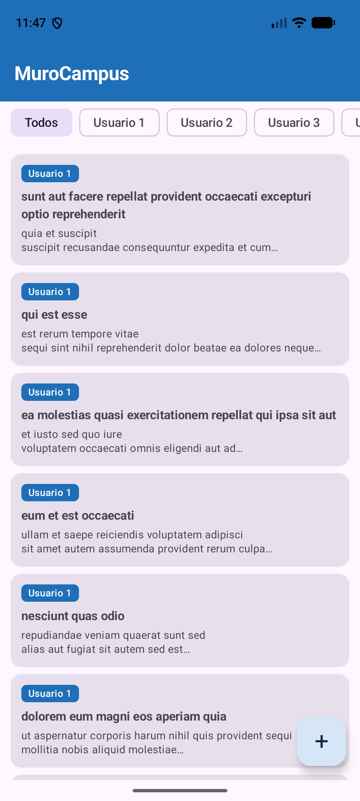
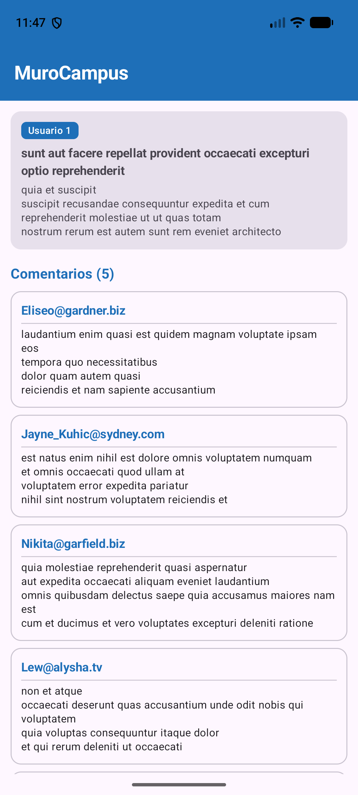
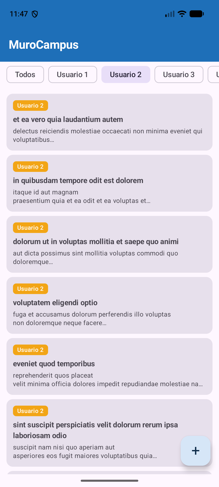
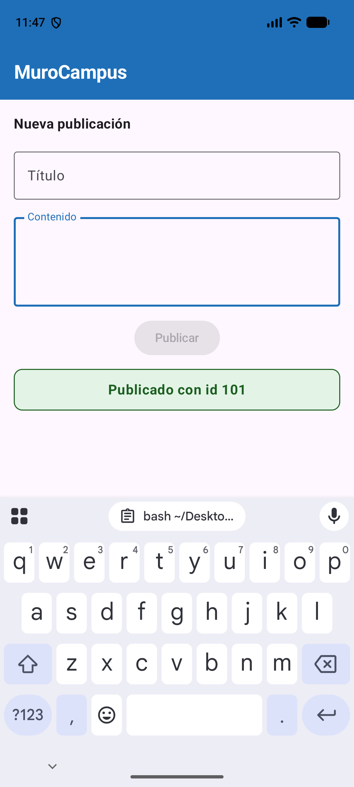
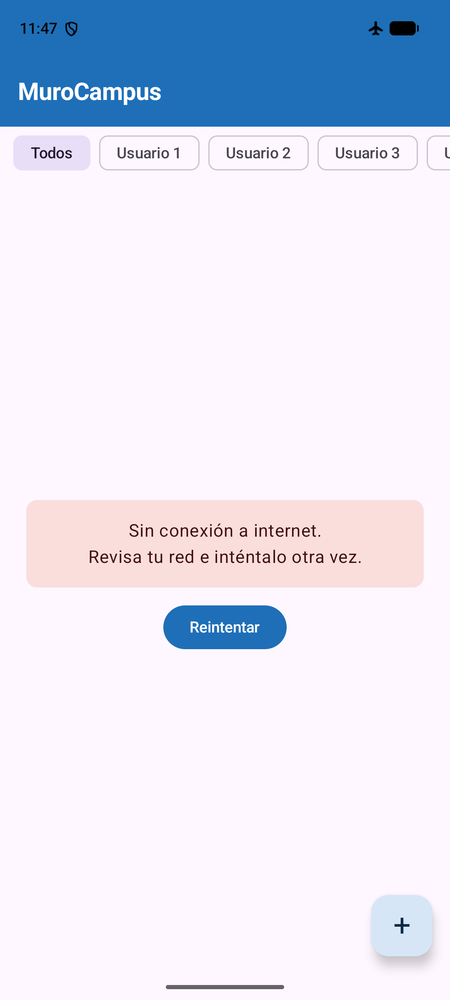

# MuroCampus

**Alumno:** Lucas Inga Marín · **Curso:** Programación en Móviles · Tecsup · **Docente:** Juan José León Suiyon

App Android (Kotlin + Jetpack Compose) que consume el servicio web REST **JSONPlaceholder**. Lista las publicaciones, muestra el detalle con sus comentarios, filtra por usuario y crea una publicación nueva con POST. Si no hay internet, muestra un mensaje de error con el botón Reintentar.

- **Red:** Retrofit 2.11 + OkHttp 4.12 (con `HttpLoggingInterceptor`) + kotlinx.serialization
- **Arquitectura:** MVVM + Repository, con `StateFlow<UiState>` (Cargando / Exito / Error) y `Result`
- **API:** `https://jsonplaceholder.typicode.com/`

## Estructura de paquetes

```
com.ingamarin.murocampus/
├── MainActivity.kt              navegacion simple (lista / detalle / crear) y BackHandler
├── model/
│   └── Modelos.kt               Post, Comentario, NuevoPost (+ Usuario)
├── data/
│   ├── remote/
│   │   ├── PostApi.kt           interface de Retrofit (@GET, @POST, @Path, @Query, @Body)
│   │   ├── UsuarioApi.kt        ejemplo resuelto
│   │   └── RetrofitClient.kt    object: OkHttp + conversor JSON, se crea una sola vez
│   ├── PostRepository.kt        interface + PostRepositoryRemote (devuelve Result)
│   └── UsuarioRepository.kt     ejemplo resuelto
├── viewmodel/
│   ├── UiState.kt               Cargando / Exito / Error + mensajeDe(e)
│   ├── PostsViewModel.kt        lista, filtro, detalle y crear
│   └── PostsViewModelFactory.kt
└── ui/
    ├── Componentes.kt           TarjetaPost, Cargando, ErrorConReintento
    ├── PantallaLista.kt         chips de filtro + LazyColumn
    ├── PantallaDetalle.kt       publicacion + comentarios
    ├── PantallaCrear.kt         formulario con POST
    └── theme/
```

## Diagrama MVVM

```
View (PantallaLista, PantallaDetalle, PantallaCrear)
  | eventos: cargar, filtrar, abrir, publicar        ^ collectAsStateWithLifecycle()
  v                                                  |
ViewModel (PostsViewModel) --- StateFlow<UiState> (Cargando / Exito / Error) --->
  | viewModelScope.launch
  v
PostRepository (interface)        <- devuelve Result<...>
  -> PostRepositoryRemote          (captura IOException, HttpException, SerializationException)
  |
  v
PostApi (Retrofit) --- OkHttp ---> https://jsonplaceholder.typicode.com/
```

La pantalla nunca llama a Retrofit. El ViewModel solo conoce la interface `PostRepository`, sin Retrofit, PostApi, HttpException ni Context.

## Endpoints usados

| Para… | Verbo y ruta | Anotación |
|---|---|---|
| Listar | `GET posts` | `@GET` |
| Detalle | `GET posts/{id}` | `@Path("id")` |
| Comentarios | `GET posts/{id}/comments` | `@Path("id")` |
| Filtrar | `GET posts?userId=2` | `@Query("userId")` |
| Crear | `POST posts` | `@Body NuevoPost` |

## Capturas

| Lista | Detalle | Filtro (Usuario 2) |
|---|---|---|
|  |  |  |

| Crear (id 101) | Error sin conexión |
|---|---|
|  |  |

## Pruebas de errores (Paso 10)

| Prueba | Resultado |
|---|---|
| Sin internet (modo avión) | "Sin conexión a internet" + Reintentar ✔ |
| Reintentar | Carga la lista ✔ |
| Recurso inexistente (`posts/9999`, temporal) | "Error del servidor (404)" ✔ |
| JSON inesperado (campo que no llega, temporal) | "Respuesta inesperada" ✔. Si llega un campo de más, funciona gracias a `ignoreUnknownKeys` |
| Cancelación (abrir detalle y volver rápido) | Sin errores en Logcat ✔ |
| Detalle | Siempre 5 comentarios ✔ |
| Filtro | Siempre 10 publicaciones por usuario ✔ |
| Crear | "Publicado con id 101" y POST 201 en Logcat ✔ |
| Código | `PostsViewModel` sin Retrofit, PostApi ni HttpException ✔ |

## Para pensar

1. **¿Diferencia entre GET y POST? ¿Por qué crear lleva @Body y porUsuario @Query?**
   GET solo lee datos y no cambia nada en el servidor. POST envía datos para crear un recurso nuevo. `crear` lleva `@Body` porque la publicación nueva viaja como JSON en el cuerpo de la petición. `porUsuario` solo filtra una lectura, así que el dato va en la URL como parámetro (`posts?userId=2`), y eso es `@Query`.

2. **¿Por qué la ruta es `"posts"` y no `"/posts"`?**
   Retrofit une la ruta con la `baseUrl`. Si la ruta empieza con `/`, se toma como absoluta desde el dominio y reemplaza el camino de la URL base. Sin la barra se agrega al final de `https://jsonplaceholder.typicode.com/`, que por eso termina en `/`.

3. **¿Por qué el Repository devuelve Result en vez de dejar escapar la excepción?**
   Así el ViewModel no necesita conocer `IOException` ni `HttpException` (Retrofit), y la app no se cierra por una excepción sin capturar. El ViewModel solo pregunta si fue éxito o fallo (`onSuccess` / `onFailure`) y lo convierte en `UiState`. Además se puede cambiar la fuente de datos sin tocar el ViewModel ni la pantalla.

4. **¿Qué pasa si olvidas el permiso INTERNET? ¿Y si olvidas ignoreUnknownKeys y el servidor agrega un campo?**
   Sin el permiso, la app compila pero no se conecta: falla con un error de red (`SecurityException` / `UnknownHostException`) y se ve "Sin conexión" aunque haya internet. Sin `ignoreUnknownKeys`, cuando el servidor agrega un campo que la data class no tiene, kotlinx.serialization lanza `SerializationException` y se ve "Respuesta inesperada".

5. **¿Por qué la lista usa un `when` sobre UiState y no un `if` con tres variables?**
   Con una `sealed interface` la pantalla solo puede estar en **un** estado a la vez, y el `when` obliga a cubrir los tres casos: el compilador avisa si falta uno. Con tres variables (`cargando`, `error`, `datos`) se pueden dar combinaciones imposibles, como cargando y error al mismo tiempo, y es fácil olvidar un caso.

6. **JSONPlaceholder no guarda los POST. ¿Cómo cambiaría con un servicio real?**
   La publicación creada sí quedaría guardada con un id real. Después del POST habría que agregarla a la lista o volver a cargarla (`cargar()`), y normalmente se enviaría un token de autenticación en un encabezado para saber quién publica. También habría que validar las respuestas de error del servidor (400, 401, 500).

## Ramas

- `main`: Fase 1, 11 commits, uno por paso
- `mejora-ia`: Fase 2, mejoras asistidas por IA y `PROMPTS.md`
